# Save Tree Graph
Click on a node below to go to its save files folder.


```mermaid
flowchart TD
	classDef default fill:#008a1e,color:white;
	classDef todo stroke-dasharray: 5 5,color:gray,fill:#FFFFFF88;
	
	classDef castle       fill: #414141,color:white;
	classDef town         fill: #503e2d,color:white;
	classDef forest       fill: #005500,color:white;
	classDef forest_town  fill: #366636,color:white;
	classDef fire         fill: #810000,color:white;
	classDef fire_town    fill: #813f3f,color:white;
	classDef water        fill: #0070a3,color:white;
	classDef water_town   fill: #558297,color:white;
	classDef shadow       fill: #69024f,color:white;
	classDef spirit       fill: #bcd100,color:black;
	classDef spirit_town  fill: #d19900,color:black;
	
	%% ------- Game Start ------- %%
	
	TitleScreen@{ shape: sm-circ, label: "Title Screen" } --> 000000
	
	subgraph ChildKokiri_01 [Kokiri Forest]
		000000[Wake up Sleepyhead!] --> 000100
		click 000000 href "https://github.com/tustin2121/OoTR-saveTree/blob/main/saves/000000_GameStart"
	
		000100[Talked to Saria] --> 000210 
		click 000100 href "https://github.com/tustin2121/OoTR-saveTree/blob/main/saves/000100_PostSaria"
		
		000210[Bought Deku Shield] --> 000220
		click 000210 href "https://github.com/tustin2121/OoTR-saveTree/blob/main/saves/000210_DekuShield"
		
		000220[Got Sword] --> 000250
		click 000220 href "https://github.com/tustin2121/OoTR-saveTree/blob/main/saves/000220_KokiriSword"
		
		000250[Passed Mido] -- Deku Tree's Task --> 000300
		click 000250 href "https://github.com/tustin2121/OoTR-saveTree/blob/main/saves/000250_PastMido"
		
		000300[Before Deku Tree] --> 000310
		click 000300 href "https://github.com/tustin2121/OoTR-saveTree/blob/main/saves/000300_BeforeDeku"
		
		subgraph DekuTree_01 [Deku Tree]
			000310[Inside Deku Tree] --> 000400
			click 000310 href "https://github.com/tustin2121/OoTR-saveTree/blob/main/saves/000310_InsideDeku"
			
			000400[Before Ghoma] --> 000450
			click 000400 href "https://github.com/tustin2121/OoTR-saveTree/blob/main/saves/000400_BeforeGhoma"
			
			000450[After Ghoma] 
			click 000450 href "https://github.com/tustin2121/OoTR-saveTree/blob/main/saves/000450_AfterGhoma"
		end
		
		000500["Spiritual Stone of Forest<br/>(1st stone)"] --> 000510
		000450 -- Deku Tree Dies --> 000500
		click 000500 href "https://github.com/tustin2121/OoTR-saveTree/blob/main/saves/000500_DekuDead"
		
		000510[After Mido runs off] --> 000520
		click 000510 href "https://github.com/tustin2121/OoTR-saveTree/blob/main/saves/000510_PostMido"
		
		000520[Before Saria's Cutscene]
		click 000510 href "https://github.com/tustin2121/OoTR-saveTree/blob/main/saves/000520_PreSaria"
	end
	class DekuTree_01 forest;
	class ChildKokiri_01 forest_town;
	
	001100[Hyrule Field Pre-Owl] -- Kaepora Gaebora --> 001110
	000520 --> 001100
	click 001100 href "https://github.com/tustin2121/OoTR-saveTree/blob/main/saves/001100_HFPreOwl"
	
	001110[Hyrule Field Post-Owl] --> 001150
	click 001110 href "https://github.com/tustin2121/OoTR-saveTree/blob/main/saves/001110_HFPostOwl"
	
	001150{Hyrule Field} --> 002000
	click 001150 href "https://github.com/tustin2121/OoTR-saveTree/blob/main/saves/001150_HyruleField"
	
	subgraph CastleTown_01 [Hyrule Castle Town]
		002000[Entering Hyrule Castle Town] --> 002100
		click 002000 href "https://github.com/tustin2121/OoTR-saveTree/blob/main/saves/002000_CastleTown"
		
		subgraph Castle_01 [Hyrule Castle]
			002100[Entering the Castle Grounds] --> 002110
			click 002100 href "https://github.com/tustin2121/OoTR-saveTree/blob/main/saves/002100_CastleEnter"
			
			002110[After Waking Talon] --> 002200
			click 002110 href "https://github.com/tustin2121/OoTR-saveTree/blob/main/saves/002110_TalonWoken"
			
			002200[Before Meeting Zelda] -- Meeting Zelda --> 002210
			click 002200 href "https://github.com/tustin2121/OoTR-saveTree/blob/main/saves/002200_BeforeZelda"
			
			002210[After Meeting Zelda] --> 002220
			click 002210 href "https://github.com/tustin2121/OoTR-saveTree/blob/main/saves/002210_AfterZelda"
			
			002220[After Learning Zelda's Lullaby]
			click 002220 href "https://github.com/tustin2121/OoTR-saveTree/blob/main/saves/002220_ZLLearned"
		end
	end
	class CastleTown_01 town;
	class Castle_01 castle;
	
	003000{Hyrule Field} --> 003100
	002220 --> 003000
	click 003000 href "https://github.com/tustin2121/OoTR-saveTree/blob/main/saves/003000_StoneQuest"
	
	subgraph Kakariko_01 [Kakariko Village]
		003100[Kakariko Village] --> 003110
		click 003100 href "https://github.com/tustin2121/OoTR-saveTree/blob/main/saves/003100_KakarikoEnter"
		
		003110[Starting Cuckoo Quest] --> 003112
		click 003110 href "https://github.com/tustin2121/OoTR-saveTree/blob/main/saves/003110_CuckooQuest1"
		
		003112[Cuckoo Quest Bottle] --> 003120
		click 003112 href "https://github.com/tustin2121/OoTR-saveTree/blob/main/saves/003112_CuckooQuest2"
		
		003120["Guard Opened Gate<br/>(skipped Happy Mask Dialog)"] --> 003130
		click 003120 href "https://github.com/tustin2121/OoTR-saveTree/blob/main/saves/003120_AfterGuard"
		
		003130["Graveyard Shield"]
		click 003130 href "https://github.com/tustin2121/OoTR-saveTree/blob/main/saves/003130_GraveyardShield"
	end
	class Kakariko_01 town;
	
	subgraph LonLon_01 [Lon Lon Ranch]
		003900[Lon Lon Ranch]
		class 003900 todo;
		%% click 003900 href "https://github.com/tustin2121/OoTR-saveTree/blob/main/saves/001150_HyruleField"
	end
	class LonLon_01 town;
	003000 -.-> 003900
	
	subgraph DeathMountain_01 [Death Mountain]
		003200["Enter Death Mountain Trail"] --> 003300
		003130 --> 003200
		click 003200 href "https://github.com/tustin2121/OoTR-saveTree/blob/main/saves/003200_DMTEnter"
		
		subgraph GoronCity_01 [Goron City]
			003300["Enter Goron City"] -- Darunia's Crash Out --> 003310
			click 003300 href "https://github.com/tustin2121/OoTR-saveTree/blob/main/saves/003300_GCEnter"
			
			003310["After Darunia"]
			click 003310 href "https://github.com/tustin2121/OoTR-saveTree/blob/main/saves/003310_Darunia"
		end
	end
	class DeathMountain_01 fire_town;
	class GoronCity_01 town;
	003310 --> 003320
	
	subgraph LostWoods_01 [Lost Woods]
		003320["Enter Sacred Grove"] --> 003330
		click 003320 href "https://github.com/tustin2121/OoTR-saveTree/blob/main/saves/003320_SFMEnter"
		
		003330["Before Saria's Song"] --> 003331
		click 003330 href "https://github.com/tustin2121/OoTR-saveTree/blob/main/saves/003330_BeforeSong"
		
		003331["After Saria's Song"]
		click 003331 href "https://github.com/tustin2121/OoTR-saveTree/blob/main/saves/003331_AfterSong"
	end
	class LostWoods_01 forest;
	003331 --> 003400
	
	subgraph DeathMountain_02 [Death Mountain]
		subgraph GoronCity_02 [Goron City]
			003400["Return to Goron City"] -- Darunia's Dance --> 003410
			click 003400 href "https://github.com/tustin2121/OoTR-saveTree/blob/main/saves/003400_GCEnter"
			
			003410["Goron Bracelet Get"]
			click 003400 href "https://github.com/tustin2121/OoTR-saveTree/blob/main/saves/003410_PostDance"
		end
		
		004000["DC Opened"] --> 004100
		003410 --> 004000
		click 004000 href "https://github.com/tustin2121/OoTR-saveTree/blob/main/saves/004000_DCOpened"
		
		subgraph Dodongos_01 [Dodongo Cavern]
			004100["Dodongo Cavern Start"] --> 004110
			click 004100 href "https://github.com/tustin2121/OoTR-saveTree/blob/main/saves/004100_DCStart"
			
			004110["Get Bomb Bag"] --> 004120
			click 004110 href "https://github.com/tustin2121/OoTR-saveTree/blob/main/saves/004110_DCBombBag"
			
			004120["Before King Dodongo"] --> 004130
			click 004120 href "https://github.com/tustin2121/OoTR-saveTree/blob/main/saves/004120_DCBeforeBoss"
			
			004130["After King Dodongo"]
			click 004130 href "https://github.com/tustin2121/OoTR-saveTree/blob/main/saves/004130_DCAfterBoss"
		end
		004130 -- Darunia's Apology --> 004150
		
		004150["Spiritual Stone of Fire<br/>(2nd Stone)"] --> 004200
		click 004150 href "https://github.com/tustin2121/OoTR-saveTree/blob/main/saves/004150_FireStone"
		
		004200[Before the Great Fairy] --> 004210
		click 004200 href "https://github.com/tustin2121/OoTR-saveTree/blob/main/saves/004200_PreFairyDins"
		
		004210[Got Din's Fire] 
		click 004210 href "https://github.com/tustin2121/OoTR-saveTree/blob/main/saves/004210_DinsFire"
	end
	class DeathMountain_02 fire_town;
	class Dodongos_01 fire;
	class GoronCity_02 town;
	004210 --> 004220
		
	subgraph Kakariko_02 [Kakariko Village]
		004220[Atop the Village Roof]
		click 004220 href "https://github.com/tustin2121/OoTR-saveTree/blob/main/saves/004220_Rooftop"
	end
	class Kakariko_02 town;
	004220 --> 004225
	
	004225{Hyrule Field} --> 004230
	class 004225 todo;
	%% click 004225 href "https://github.com/tustin2121/OoTR-saveTree/blob/main/saves/004225_HyruleField"
	
	subgraph CastleTown_02 [Hyrule Castle Town]
		004230[Castle Town Nighttime] --> 004240
		click 004230 href "https://github.com/tustin2121/OoTR-saveTree/blob/main/saves/004230_CastleTown"
		
		subgraph Castle_02 [Hyrule Castle]
			004240["Castle Grounds Nighttime (ft. Malon and Talon)"] --> 004250
			click 004240 href "https://github.com/tustin2121/OoTR-saveTree/blob/main/saves/004240_CastleGrounds"
			
			004250[Before the Great Fairy] --> 004260
			click 004250 href "https://github.com/tustin2121/OoTR-saveTree/blob/main/saves/004250_PreFairySpin"
			
			004260[Got Spin Attack] -- Impa directs to Zora --> 004270
			click 004260 href "https://github.com/tustin2121/OoTR-saveTree/blob/main/saves/004260_SpinAttack"
			
			004270[Princess Zelda at Night]
			click 004270 href "https://github.com/tustin2121/OoTR-saveTree/blob/main/saves/004270_Zelda"
		end
	end
	class CastleTown_02 town;
	class Castle_02 castle;
	004270 --> 005000
	
	subgraph ZorasRiver_01 [Zora's River]
		005000[Enter Zora's River] --> 005100
		click 005000 href "https://github.com/tustin2121/OoTR-saveTree/blob/main/saves/005000_ZoraRiverStart"
		
		005100[Enter Zora's Domain] --> 005110
		click 005100 href "https://github.com/tustin2121/OoTR-saveTree/blob/main/saves/005100_ZDEnter"
		
		005110[Silver Scale]
		click 005110 href "https://github.com/tustin2121/OoTR-saveTree/blob/main/saves/005110_SilverScale"
	end
	class ZorasRiver_01 water_town;
	
	005120[Lake Hylia Enter] --> 005130
	005110 --> 005120
	click 005120 href "https://github.com/tustin2121/OoTR-saveTree/blob/main/saves/005120_LHEnter"
	
	subgraph ZorasRiver_02 [Zora's River]
		005130[Before King Zora] -- Mweep Mweep Mweep Mweep --> 005140
		click 005130 href "https://github.com/tustin2121/OoTR-saveTree/blob/main/saves/005130_BeforeKing"
		
		005140[Enter Zora's Fountain] --> 005150
		click 005140 href "https://github.com/tustin2121/OoTR-saveTree/blob/main/saves/005140_AfterKing"
		
		005150[Got Farore's Wind] --> 006000
		click 005150 href "https://github.com/tustin2121/OoTR-saveTree/blob/main/saves/005150_FaroresWind"
		
		subgraph JabuJabu_01 [Lord Jabu-Jabu's Belly]
			006000[Enter Jabu] --> 006100
			click 006000 href "https://github.com/tustin2121/OoTR-saveTree/blob/main/saves/006000_JabuStart"
			
			006100[After Ruto Falls] --> 006200
			click 006100 href "https://github.com/tustin2121/OoTR-saveTree/blob/main/saves/006100_JabuRuto"
			
			006200[Back Upstairs] --> 006300
			click 006200 href "https://github.com/tustin2121/OoTR-saveTree/blob/main/saves/006200_JabuUpstairs"
			
			006300[Got Boomerang] --> 006400
			click 006300 href "https://github.com/tustin2121/OoTR-saveTree/blob/main/saves/006300_Boomerang"
			
			006400[Final Tentacle Dead] --> 006500
			click 006400 href "https://github.com/tustin2121/OoTR-saveTree/blob/main/saves/006400_LastTentacle"
			
			006500[After Mini-Boss] --> 006610
			click 006500 href "https://github.com/tustin2121/OoTR-saveTree/blob/main/saves/006500_AfterMiniboss"
			
			006610[Before Baranade] --> 006620
			click 006610 href "https://github.com/tustin2121/OoTR-saveTree/blob/main/saves/006610_BeforeBoss"
			
			006620[After Baranade] --> 006650
			click 006620 href "https://github.com/tustin2121/OoTR-saveTree/blob/main/saves/006620_AfterBoss"
		end
		
		006650["Spiritual Stone of Water<br/>(3rd stone)"]
		click 006650 href "https://github.com/tustin2121/OoTR-saveTree/blob/main/saves/006650_WaterStone"
	end
	class ZorasRiver_02 water_town;
	class JabuJabu_01 water;
	
	007100[Lake Hylia] -- Owl Flight --> 007000
	006650 --> 007100
	click 007100 href "https://github.com/tustin2121/OoTR-saveTree/blob/main/saves/007100_LakeHylia"
	
	
	%% ------- Alternate Spiritual Stone Quest ------- %%
	
	004110 --> A04225
	A04225{Hyrule Field} --> A04230
	class A04225 todo;
	%% click A04225 href "https://github.com/tustin2121/OoTR-saveTree/blob/main/saves/A04225_HyruleField"
	
	subgraph CastleTown_02A [Hyrule Castle Town]
		A04230[Castle Town Nighttime] --> A04240
		class A04230 todo; 
		%% click A04230 href "https://github.com/tustin2121/OoTR-saveTree/blob/main/saves/A04230_CastleTown"
		
		subgraph Castle_02A [Hyrule Castle]
			A04240["Castle Grounds Nighttime (ft. Malon and Talon)"] --> A04250
			class A04240 todo; 
			%% click A04240 href "https://github.com/tustin2121/OoTR-saveTree/blob/main/saves/A04240_CastleGrounds"
			
			A04250[Before the Great Fairy] --> A04260
			class A04250 todo; 
			%% click A04250 href "https://github.com/tustin2121/OoTR-saveTree/blob/main/saves/A04250_PreFairySpin"
			
			A04260[Got Spin Attack] -- Impa directs to Zora --> A04270
			class A04260 todo; 
			%% click A04260 href "https://github.com/tustin2121/OoTR-saveTree/blob/main/saves/A04260_SpinAttack"
			
			A04270[Princess Zelda at Night]
			class A04270 todo; 
			%% click A04270 href "https://github.com/tustin2121/OoTR-saveTree/blob/main/saves/A04270_Zelda"
		end
	end
	class CastleTown_02A town;
	class Castle_02A castle;
	A04270 --> A05000
	
	subgraph ZorasRiver_01A [Zora's River]
		A05000[Enter Zora's River] --> A05100
		class A05000 todo; 
		%% click A05000 href "https://github.com/tustin2121/OoTR-saveTree/blob/main/saves/A05000_ZoraRiverStart"
		
		A05100[Enter Zora's Domain] --> A05110
		class A05100 todo; 
		%% click A05100 href "https://github.com/tustin2121/OoTR-saveTree/blob/main/saves/A05100_ZDEnter"
		
		A05110[Silver Scale]
		class A05110 todo; 
		%% click A05110 href "https://github.com/tustin2121/OoTR-saveTree/blob/main/saves/A05110_SilverScale"
	end
	class ZorasRiver_01A water_town;
	
	A05120[Lake Hylia Enter] --> A05130
	class A05120 todo; 
	A05110 --> A05120
	%% click A05120 href "https://github.com/tustin2121/OoTR-saveTree/blob/main/saves/A05120_LHEnter"
	
	subgraph ZorasRiver_02A [Zora's River]
		A05130[Before King Zora] -- Mweep Mweep Mweep Mweep --> A05140
		class A05130 todo; 
		%% click A05130 href "https://github.com/tustin2121/OoTR-saveTree/blob/main/saves/A05130_BeforeKing"
		
		A05140[Enter Zora's Fountain] --> A05150
		class A05140 todo; 
		%% click A05140 href "https://github.com/tustin2121/OoTR-saveTree/blob/main/saves/A05140_AfterKing"
		
		A05150[Got Farore's Wind] --> A06000
		class A05150 todo; 
		%% click A05150 href "https://github.com/tustin2121/OoTR-saveTree/blob/main/saves/A05150_FaroresWind"
		
		subgraph JabuJabu_01A [Lord Jabu-Jabu's Belly]
			A06000[Enter Jabu] --> A06100
			class A06000 todo; 
			%% click A06000 href "https://github.com/tustin2121/OoTR-saveTree/blob/main/saves/A06000_JabuStart"
			
			A06100[After Ruto Falls] --> A06200
			class A06100 todo; 
			%% click A06100 href "https://github.com/tustin2121/OoTR-saveTree/blob/main/saves/A06100_JabuRuto"
			
			A06200[Back Upstairs] --> A06300
			class A06200 todo; 
			%% click A06200 href "https://github.com/tustin2121/OoTR-saveTree/blob/main/saves/A06200_JabuUpstairs"
			
			A06300[Got Boomerang] --> A06400
			class A06300 todo; 
			%% click A06300 href "https://github.com/tustin2121/OoTR-saveTree/blob/main/saves/A06300_Boomerang"
			
			A06400[Final Tentacle Dead] --> A06500
			class A06400 todo; 
			%% click A06400 href "https://github.com/tustin2121/OoTR-saveTree/blob/main/saves/A06400_LastTentacle"
			
			A06500[After Mini-Boss] --> A06610
			class A06500 todo; 
			%% click A06500 href "https://github.com/tustin2121/OoTR-saveTree/blob/main/saves/A06500_AfterMiniboss"
			
			A06610[Before Baranade] --> A06620
			class A06610 todo; 
			%% click A06610 href "https://github.com/tustin2121/OoTR-saveTree/blob/main/saves/A06610_BeforeBoss"
			
			A06620[After Baranade] --> A06650
			class A06620 todo; 
			%% click A06620 href "https://github.com/tustin2121/OoTR-saveTree/blob/main/saves/A06620_AfterBoss"
		end
		
		A06650["Spiritual Stone of Water<br/>(2nd stone)"]
		class A06650 todo; 
		%% click A06650 href "https://github.com/tustin2121/OoTR-saveTree/blob/main/saves/A06650_WaterStone"
	end
	class ZorasRiver_02A water_town;
	class JabuJabu_01A water;
	A06650 --> A04120
	
	subgraph DeathMountain_02A [Death Mountain]
		subgraph Dodongos_02A [Dodongo Cavern]
			A04120["Before King Dodongo"] --> A04130
			class A04120 todo;
		%%	click A04120 href "https://github.com/tustin2121/OoTR-saveTree/blob/main/saves/A04120_DCBeforeBoss"
			
			A04130["After King Dodongo"]
			class A04130 todo;
		%%	click A04130 href "https://github.com/tustin2121/OoTR-saveTree/blob/main/saves/A04130_DCAfterBoss"
		end
		A04130 -- Darunia's Apology --> A04150
		
		A04150["Spiritual Stone of Fire (3rd Stone)"]
		class A04150 todo;
		%%click A04150 href "https://github.com/tustin2121/OoTR-saveTree/blob/main/saves/A04150_FireStone"
	end
	class DeathMountain_02A fire_town;
	class Dodongos_02A fire;
	A04150 -.-> 007000
	
	%% ------- Glitched Timeline ------- %%
	
	subgraph ZorasRiver_02G [Zora's River]
		
		G00100[Forest Escape] --> G00200
		000100 --> G00100
		class G00100 todo;
		click G00100 href "https://github.com/tustin2121/OoTR-saveTree/blob/main/saves/G00100_ForestEscape"
		
		G00200[Zora's Domain] --> G00210
		class G00200 todo;
		click G00200 href "https://github.com/tustin2121/OoTR-saveTree/blob/main/saves/G00200_PostSaria"
		
		G00210[Silver Scale] 
		class G00210 todo;
		click G00210 href "https://github.com/tustin2121/OoTR-saveTree/blob/main/saves/G00210_PostSaria"
		
	end
	class ZorasRiver_02G water_town;
	

	%% ------- End of Child 1 ------- %%
	
	007000{Hyrule Field}
	click 007000 href "https://github.com/tustin2121/OoTR-saveTree/blob/main/saves/007000_HyruleField"
	
	007000 -- "Zelda's Escape<br/>(Cannot Save)" --> 
	
	%% 007200[/"Zelda's Escape<br/>(Cannot Save)"/] --> 007210
	%% click 007200 href "https://github.com/tustin2121/OoTR-saveTree/blob/main/saves/007200_AfterEscape"
	
	007210["Got Ocarina of Time"] --> 007220
	click 007210 href "https://github.com/tustin2121/OoTR-saveTree/blob/main/saves/007210_AfterOcarina"
	
	subgraph CastleTown_04 [Hyrule Castle Town]
		007220["Castle Town<br/>(ft. Malon & Talon)"]
		click 007220 href "https://github.com/tustin2121/OoTR-saveTree/blob/main/saves/007220_CastleTown"
	end
	
	subgraph LonLon_05 [Lon Lon Ranch]
		007230["Lon Lon Ranch"] --> 007240
		007220 --> 007230
		click 007230 href "https://github.com/tustin2121/OoTR-saveTree/blob/main/saves/007230_LonLon"
		
		007240["Got Epona's Song"] --> 007250
		click 007240 href "https://github.com/tustin2121/OoTR-saveTree/blob/main/saves/007240_EponaSong"
	end
	class LonLon_05 town;
	
	subgraph CastleTown_05 [Hyrule Castle Town]
		007250["Castle Town"] --> 007290
		click 007250 href "https://github.com/tustin2121/OoTR-saveTree/blob/main/saves/007250_CastleTown"
		
		007290["The Master Sword Awaits"]
		click 007290 href "https://github.com/tustin2121/OoTR-saveTree/blob/main/saves/007290_DoorOfTime"
	end
	class CastleTown_04,CastleTown_05 town;

	%% ------- Master Sword ------- %%
	
	MasterSwordCS@{ shape: trap-b, label: "Master Sword<br/>Cutscene" }
	style MasterSwordCS fill:gray;
	TimeTravel_01@{ shape: hourglass, label: "." }
	007290 --> MasterSwordCS --> TimeTravel_01
	
```

```mermaid
flowchart TD
	classDef default fill:#008a1e,color:white;
	classDef todo stroke-dasharray: 5 5,color:gray,fill:#FFFFFF88;
	
	classDef castle       fill: #414141,color:white;
	classDef town         fill: #503e2d,color:white;
	classDef forest       fill: #005500,color:white;
	classDef forest_town  fill: #366636,color:white;
	classDef fire         fill: #810000,color:white;
	classDef fire_town    fill: #813f3f,color:white;
	classDef water        fill: #0070a3,color:white;
	classDef water_town   fill: #558297,color:white;
	classDef shadow       fill: #69024f,color:white;
	classDef spirit       fill: #bcd100,color:black;
	classDef spirit_town  fill: #d19900,color:black;
	
	TimeTravel_01@{ shape: hourglass, label: "." }
	TimeTravel_01 --> 010000
	
	subgraph CastleTown_50 [Castle Town Ruins]
		010000["The Future"]
		click 010000 href "https://github.com/tustin2121/OoTR-saveTree/blob/main/saves/010000_Shiek"
	end
	class CastleTown_50 castle;
	
	010100{Hyrule Field}
	010000 --> 010100
	click 010100 href "https://github.com/tustin2121/OoTR-saveTree/blob/main/saves/010100_HyruleField"
	
	subgraph LonLon_10 [Ingo Ranch]
		010200["Epona has been Tamed"] --> 010210
		010100 --> 010200
		click 010200 href "https://github.com/tustin2121/OoTR-saveTree/blob/main/saves/010200_EponaSong"
		
		010210["Epona has been Won"] --> 010230
		click 010210 href "https://github.com/tustin2121/OoTR-saveTree/blob/main/saves/010210_EponaWin"
		
		010230["Outside the Ranch without Epona"] --> 010250
		click 010230 href "https://github.com/tustin2121/OoTR-saveTree/blob/main/saves/010230_IngoScare"
		
		010250["Epona Escaped"]
		click 010250 href "https://github.com/tustin2121/OoTR-saveTree/blob/main/saves/010250_EponaEscape"
	end
	class LonLon_10 town;
	010250 --> 011100
	010250 --> 01221A
	
	01221A[Minuet without Hookshot]
	click 01221A href "https://github.com/tustin2121/OoTR-saveTree/blob/main/saves/01221A_ForestSongHookshotless"
	
	
	%% ======== Path 0: Game Intended Order ======== %%
	
	%% ------- Forest Temple ------- %%
	
	subgraph Kakariko_02 [Kakariko Village]
		011100[Enter Kakariko Village] --> 011120
		click 011100 href "https://github.com/tustin2121/OoTR-saveTree/blob/main/saves/011100_Kakariko"
		
		011120[Got the Pocket Cuckoo Egg] --> 011200
		click 011120 href "https://github.com/tustin2121/OoTR-saveTree/blob/main/saves/011120_TradeQuest1"
		
		011200[Enter the Graveyard] --> 011205
		click 011200 href "https://github.com/tustin2121/OoTR-saveTree/blob/main/saves/011200_Graveyard"
		
		011205[Enter Dampe's Grave] --> 011300
		click 011205 href "https://github.com/tustin2121/OoTR-saveTree/blob/main/saves/011205_DampeGrave"
		
		011300[Got Hookshot] --> 011310
		click 011300 href "https://github.com/tustin2121/OoTR-saveTree/blob/main/saves/011300_Hookshot"
		
		011310[Song of Storms] --> 011320
		click 011310 href "https://github.com/tustin2121/OoTR-saveTree/blob/main/saves/011310_StormsSong"
		
		011320[Talon's Wake Up Call] --> 011330
		click 011320 href "https://github.com/tustin2121/OoTR-saveTree/blob/main/saves/011320_TalonAwoken"
		
		011330[Cojiro's Mum]
		click 011330 href "https://github.com/tustin2121/OoTR-saveTree/blob/main/saves/011330_TradeQuest2"
	end
	class Kakariko_02 town;
	
	011400{Hyrule Field}
	click 011400 href "https://github.com/tustin2121/OoTR-saveTree/blob/main/saves/011400_HyruleField"
	011330 --> 011400 --> 012000
	
	012010 --> 011420 --> 011440 --> 011450
	
	subgraph AdultKokiri_01 [Kokiri Forest]
		012000[Monsters in Kokiri] --> 012010
		click 012000 href "https://github.com/tustin2121/OoTR-saveTree/blob/main/saves/012000_KokiriForest"
		
		012010[Lost Woods]
		click 012010 href "https://github.com/tustin2121/OoTR-saveTree/blob/main/saves/012010_LostWoods"
		
		011420[Cojiro's Owner]
		class 011420 todo;
		click 011420 href "https://github.com/tustin2121/OoTR-saveTree/blob/main/saves/011420_TradeQuest3"
	end
	class AdultKokiri_01 forest_town;
	
	subgraph Kakariko_03 [Kakariko Village]
		011440[Granny's Potions]
		click 011440 href "https://github.com/tustin2121/OoTR-saveTree/blob/main/saves/011440_TradeQuest4"
	end
	class Kakariko_03 town;
	
	subgraph AdultKokiri_02 [Lost Woods]
		011450[Everybody Stalfos] --> 012100
		click 011450 href "https://github.com/tustin2121/OoTR-saveTree/blob/main/saves/011450_TradeQuest5"
		
		012100[Before speaking with Mido] --> 012101
		click 012100 href "https://github.com/tustin2121/OoTR-saveTree/blob/main/saves/012100_PreMido"
		
		012101[After speaking with Mido] --> 012102
		click 012101 href "https://github.com/tustin2121/OoTR-saveTree/blob/main/saves/012101_PeriMido"
		
		012102[After Saria's Song for Mido] --> 012200
		click 012102 href "https://github.com/tustin2121/OoTR-saveTree/blob/main/saves/012102_PostMido"
		
		012200[Sacred Grove] --> 012210
		click 012200 href "https://github.com/tustin2121/OoTR-saveTree/blob/main/saves/012200_SFMEnter"
		
		012210[Minuet of the Forest] --> 012300
		click 012210 href "https://github.com/tustin2121/OoTR-saveTree/blob/main/saves/012210_ForestSong"
		
		subgraph ForestTemple_01 [Forest Temple]
			012300[Forest Temple] --> 012450
			click 012300 href "https://github.com/tustin2121/OoTR-saveTree/blob/main/saves/012300_ForestStart"
			
			012450[Center of Forest] --> 012500
			click 012450 href "https://github.com/tustin2121/OoTR-saveTree/blob/main/saves/012450_Ghosts"
			
			012500[Get Fairy Bow] --> 012520
			click 012500 href "https://github.com/tustin2121/OoTR-saveTree/blob/main/saves/012500_BowGet"
			
			012520[Before Green Poe] --> 012800
			click 012520 href "https://github.com/tustin2121/OoTR-saveTree/blob/main/saves/012520_GreenPoe"
			
			012800[Before Phantom Ganon] --> 012810
			click 012800 href "https://github.com/tustin2121/OoTR-saveTree/blob/main/saves/012800_ForestPreBoss"
			
			012810[After Phantom Ganon]
			click 012810 href "https://github.com/tustin2121/OoTR-saveTree/blob/main/saves/012810_ForestPostBoss"
		end
		
		012900[Forest Medallion] --> 012950
		012810 --> 012900
		click 012900 href "https://github.com/tustin2121/OoTR-saveTree/blob/main/saves/012900_ForestMedallion"
		
		012950[Mido Afterwards]
		click 012950 href "https://github.com/tustin2121/OoTR-saveTree/blob/main/saves/012950_MidoAfterwards"
	end
	class AdultKokiri_02 forest_town;
	class ForestTemple_01 forest;
	
	%% ------- Fire Temple ------- %%
	012950 -- Via Lost Woods --> 013000
	
	subgraph GoronCity_52 [Goron City]
		013000[Goron City is Empty] --> 013010
		click 013000 href "https://github.com/tustin2121/OoTR-saveTree/blob/main/saves/013000_GoronCity"
		
		013010[Link the Goron / Goron Tunic] --> 013100
		click 013010 href "https://github.com/tustin2121/OoTR-saveTree/blob/main/saves/013010_GoronLink"
		
		013100[Bolero of Fire]
		click 013100 href "https://github.com/tustin2121/OoTR-saveTree/blob/main/saves/013100_FireSong"
	end
	class GoronCity_52 fire_town;
	
	013110[Kakariko Village] --> 013120
	013100 --> 013110
	click 013110 href "https://github.com/tustin2121/OoTR-saveTree/blob/main/saves/013110_Kakariko"
	
	013120[Prelude of Light] --> 013140
	click 013120 href "https://github.com/tustin2121/OoTR-saveTree/blob/main/saves/013120_Prelude"
	
	013140[Returning with a Fifth Poe] --> 013150
	click 013140 href "https://github.com/tustin2121/OoTR-saveTree/blob/main/saves/013140_PoeCollecting5"
	
	013150[Final Bottle] --> 013200
	click 013150 href "https://github.com/tustin2121/OoTR-saveTree/blob/main/saves/013150_Bottle5"
	
	
	subgraph FireTemple_01 [Fire Temple]
		013200[Fire Temple] --> 013210
		click 013200 href "https://github.com/tustin2121/OoTR-saveTree/blob/main/saves/013200_FireStart"
		
		013210[Darunia Goes to Die] --> 013250
		click 013210 href "https://github.com/tustin2121/OoTR-saveTree/blob/main/saves/013210_FireDarunia"
		
		013250[Hammer Get!] --> 013280
		click 013250 href "https://github.com/tustin2121/OoTR-saveTree/blob/main/saves/013250_HammerGet"
		
		013280[Before Volvagia] --> 013285
		click 013280 href "https://github.com/tustin2121/OoTR-saveTree/blob/main/saves/013280_PreFireBoss"
		
		013285[After Volvagia] --> 013290
		click 013285 href "https://github.com/tustin2121/OoTR-saveTree/blob/main/saves/013285_PostFireBoss"
		
		013290[Fire Medallion]
		click 013290 href "https://github.com/tustin2121/OoTR-saveTree/blob/main/saves/013290_FireMedallion"
	end
	class FireTemple_01 fire;
	013290 --> 
	
	013500[Got Double Magic] --> 013600
	click 013500 href "https://github.com/tustin2121/OoTR-saveTree/blob/main/saves/013500_DoubleMagic"
	
	013600{Hyrule Field} --> 014000
	click 013600 href "https://github.com/tustin2121/OoTR-saveTree/blob/main/saves/013600_HyruleField"
	
	%% ------- Water Temple ------- %%
	
	subgraph ZoraDomain_52 [Zora's Domain]
		014000[Zora's Domain is Frozen] --> 014100
		click 014000 href "https://github.com/tustin2121/OoTR-saveTree/blob/main/saves/014000_ZoraDomain"
		
		subgraph IceCavern_01 [Ice Cavern]
			014100[Ice Cavern] --> 014110
			click 014100 href "https://github.com/tustin2121/OoTR-saveTree/blob/main/saves/014100_IceCavernStart"
			
			014110[Pre Iron Boots] --> 014120
			click 014110 href "https://github.com/tustin2121/OoTR-saveTree/blob/main/saves/014110_PreIronBoots"
			
			014120[Serenade of Water]
			click 014120 href "https://github.com/tustin2121/OoTR-saveTree/blob/main/saves/014120_WaterSong"
		end
		
		014130[Got Zora Tunic]
		click 014130 href "https://github.com/tustin2121/OoTR-saveTree/blob/main/saves/014130_ZoraTunic"
		
	end
	class ZoraDomain_52 water_town;
	class IceCavern_01 water;
	014120 --> 014130 --> 014150
	
	014150[Lake Hylia] --> 014200
	click 014150 href "https://github.com/tustin2121/OoTR-saveTree/blob/main/saves/014150_LakeHylia"
	
	subgraph WaterTemple_01 [Water Temple]
		014200[Water Temple Start] --> 014250
		click 014200 href "https://github.com/tustin2121/OoTR-saveTree/blob/main/saves/014200_WaterStart"
		
		014250[Before Dark Link] --> 014255
		click 014250 href "https://github.com/tustin2121/OoTR-saveTree/blob/main/saves/014250_PreDarkLink"
		
		014255[After Dark Link] --> 014260
		click 014255 href "https://github.com/tustin2121/OoTR-saveTree/blob/main/saves/014255_PostDarkLink"
		
		014260[Got Longshot] --> 014280
		click 014260 href "https://github.com/tustin2121/OoTR-saveTree/blob/main/saves/014260_Longshot"
		
		014280[Before Morpha] --> 014285
		click 014280 href "https://github.com/tustin2121/OoTR-saveTree/blob/main/saves/014280_BeforeWaterBoss"
		
		014285[After Morpha] --> 014500
		click 014285 href "https://github.com/tustin2121/OoTR-saveTree/blob/main/saves/014285_AfterWaterBoss"
		
		014500[Water Medallion]
		click 014500 href "https://github.com/tustin2121/OoTR-saveTree/blob/main/saves/014500_WaterMedallion"
	end
	class WaterTemple_01 water;
	
	014500 -->
	014510[Fire Arrows]
	click 014510 href "https://github.com/tustin2121/OoTR-saveTree/blob/main/saves/014510_FireArrows"
	014510 --> 014600
	
	014600{Hyrule Field} --> 014610
	click 014600 href "https://github.com/tustin2121/OoTR-saveTree/blob/main/saves/014600_HyruleField"
	
	subgraph Kakariko_40 [Kakariko Village]
		014610[Kakariko is Burning]
		click 014610 href "https://github.com/tustin2121/OoTR-saveTree/blob/main/saves/014610_ShadowSong"
	end
	class Kakariko_40 town;
	
	014610 --> 
	TimeTravel_02@{ shape: hourglass, label: "." }
	
	%% ------- Bottom of the Well ------- %%
	
	TimeTravel_02 --> 
	
	015000[Back in Time] --> 015010
	class 015000 todo;
	click 015000 href "https://github.com/tustin2121/OoTR-saveTree/blob/main/saves/015000_Child02"
	
	subgraph Kakariko_61 [Kakariko Village]
		015010[Royal Family's Grave] --> 015050
		click 015010 href "https://github.com/tustin2121/OoTR-saveTree/blob/main/saves/015010_BeforeSuns"
		
		015050[Sun's Song] --> 015100
		click 015050 href "https://github.com/tustin2121/OoTR-saveTree/blob/main/saves/015050_AfterSuns"
		
		015100[Before Ruining This Man's Life] -- Song of Storms --> 015150
		click 015100 href "https://github.com/tustin2121/OoTR-saveTree/blob/main/saves/015100_BeforeStorms"
		
		015150[Song of Storms] --> 015200
		click 015150 href "https://github.com/tustin2121/OoTR-saveTree/blob/main/saves/015150_StormsSong"
		
		subgraph Well_60 [Bottom of the Well]
			015200[Bottom of the Well]
			click 015200 href "https://github.com/tustin2121/OoTR-saveTree/blob/main/saves/015200_BotW"
			
			015200-->
			015250[Lenses of Truth]
			click 015250 href "https://github.com/tustin2121/OoTR-saveTree/blob/main/saves/015250_LensesTruth"
		end
		
	end
	class Well_60 shadow;
	class Kakariko_61 town;
	
	015250--> 
	015900{Hyrule Field}
	click 015900 href "https://github.com/tustin2121/OoTR-saveTree/blob/main/saves/015900_HyruleField"
	
	015900 -->
	TimeTravel_03@{ shape: hourglass, label: "." }
	
	TimeTravel_03 --> 
	015910[Back to the Future]
	click 015910 href "https://github.com/tustin2121/OoTR-saveTree/blob/main/saves/015910_Adult02"
	
	%% ------- Shadow Temple ------- %%
	
	015910 --> 016100
	subgraph Kakariko_60 [Kakariko Village]
		%% 016000[Kakariko is Burning] --> 016100
		%% class 016000 todo;
		%% click 016000 href "https://github.com/tustin2121/OoTR-saveTree/blob/main/saves/016000_ShadowSong"
		
		subgraph Shadow_01 [Shadow Temple]
			016100[Shadow Temple] --> 016200
			click 016100 href "https://github.com/tustin2121/OoTR-saveTree/blob/main/saves/016100_ShadowStart"
			
			016200[Hover Boots] --> 016300
			click 016200 href "https://github.com/tustin2121/OoTR-saveTree/blob/main/saves/016200_HoverBoots"
			
			016300[The Shadow Ship Awaits] --> 016350
			click 016300 href "https://github.com/tustin2121/OoTR-saveTree/blob/main/saves/016300_PreShadowShip"
			
			016350[Deep Shadow] --> 016360
			click 016350 href "https://github.com/tustin2121/OoTR-saveTree/blob/main/saves/016350_PostShadowShip"
			
			016360[Before the Crushing Room] --> 016500
			click 016360 href "https://github.com/tustin2121/OoTR-saveTree/blob/main/saves/016360_CrushingRoom"
			
			016500[Before Bongo Bongo] --> 016550
			click 016500 href "https://github.com/tustin2121/OoTR-saveTree/blob/main/saves/016500_PreShadowBoss"
			
			016550[After Bongo Bongo]
			click 016550 href "https://github.com/tustin2121/OoTR-saveTree/blob/main/saves/016550_PostShadowBoss"
		end
		
		016550 --> 
		016900[Shadow Medallion]
		click 016900 href "https://github.com/tustin2121/OoTR-saveTree/blob/main/saves/016900_ShadowMedallion"
	end
	class Kakariko_60 town;
	class Shadow_01 shadow;
	016900 --> 016910
	
	016910{Hyrule Field}
	click 016910 href "https://github.com/tustin2121/OoTR-saveTree/blob/main/saves/016910_HyruleField"
	
	%% ------- Spirit Temple ------- %%
	
	016910 --> 017000
	subgraph GerudoValley_50 [Gerudo Valley]
		017000[Gerudo Valley]
		click 017000 href "https://github.com/tustin2121/OoTR-saveTree/blob/main/saves/017000_GerudoValley"
		017000 --> 017100
		
		subgraph Foretress_01 [Gerudo Fortress]
			017100[Gerudo Fortress] --> 017190
			click 017100 href "https://github.com/tustin2121/OoTR-saveTree/blob/main/saves/017100_GerudoFortress"
			
			017110[Captured] --> 017190
			click 017110 href "https://github.com/tustin2121/OoTR-saveTree/blob/main/saves/017110_Captured"
			
			017120[Guard 1 Dafeated] --> 017190
			click 017120 href "https://github.com/tustin2121/OoTR-saveTree/blob/main/saves/017120_GuardDefeat1"
			
			017190[Gerudo Pass] --> 017200
			click 017190 href "https://github.com/tustin2121/OoTR-saveTree/blob/main/saves/017190_GerudoPass"
			
			017200[Gerudo Proving Grounds] --> 017280
			click 017200 href "https://github.com/tustin2121/OoTR-saveTree/blob/main/saves/017200_GTG"
			
			017280[Ice Arrows]
			click 017280 href "https://github.com/tustin2121/OoTR-saveTree/blob/main/saves/017280_IceArrows"
		end
		
		017280 --> 
		017300[Haunted Wasteland / Mirage Desert] --> 017400
		click 017300 href "https://github.com/tustin2121/OoTR-saveTree/blob/main/saves/017300_HauntedWasteland"
		
		subgraph Spirit_01 [Spirit Temple]
			017400[Desert Colossus] --> 017405
			click 017400 href "https://github.com/tustin2121/OoTR-saveTree/blob/main/saves/017400_DesertColossus"
			
			017405[Requium of Spirit] --> TimeTravel_10
			click 017405 href "https://github.com/tustin2121/OoTR-saveTree/blob/main/saves/017405_SpiritSong"
			
			TimeTravel_10@{ shape: hourglass, label: "." } -->
			
			017410[Meeting Noboru] --> 017440
			click 017410 href "https://github.com/tustin2121/OoTR-saveTree/blob/main/saves/017410_ChildSpiritStart"
			
			017440[The Iron Knuckle] --> 017460
			click 017440 href "https://github.com/tustin2121/OoTR-saveTree/blob/main/saves/017440_PreMiniBoss1"
			
			017460[The Iron Knuckle Defeated] --> 017490
			click 017460 href "https://github.com/tustin2121/OoTR-saveTree/blob/main/saves/017460_PreSilvers"
			
			017490[Got Silver Gauntlets] --> 017495
			click 017490 href "https://github.com/tustin2121/OoTR-saveTree/blob/main/saves/017490_SilverGaunts"
			
			017495[Goodbye Large Owel] --> TimeTravel_11
			click 017495 href "https://github.com/tustin2121/OoTR-saveTree/blob/main/saves/017495_OwlFinal"
			
			TimeTravel_11@{ shape: hourglass, label: "." } -->
			
			017500[Adult Spirit Temple] --> 017550
			click 017500 href "https://github.com/tustin2121/OoTR-saveTree/blob/main/saves/017500_AdultSpiritStart"
			
			017550[Mirror Shield] --> 017800
			class 017550 todo;
			click 017550 href "https://github.com/tustin2121/OoTR-saveTree/blob/main/saves/017550_MirrorShield"
			
			017800[Before Naburu] --> 017820
			class 017800 todo;
			click 017800 href "https://github.com/tustin2121/OoTR-saveTree/blob/main/saves/017800_PreSpiritMiniBoss"
			
			017820[Before Twinrova] --> 017850
			class 017820 todo;
			click 017820 href "https://github.com/tustin2121/OoTR-saveTree/blob/main/saves/017820_PreSpiritBoss"
			
			017850[After Twinrova]
			class 017850 todo;
			click 017850 href "https://github.com/tustin2121/OoTR-saveTree/blob/main/saves/017850_PostSpiritBoss"
		end
		
		017850 --> 
		017900[Spirit Medallion]
		class 017900 todo;
		click 017900 href "https://github.com/tustin2121/OoTR-saveTree/blob/main/saves/017900_SpiritMedallion"
	end
	class GerudoValley_50 spirit_town;
	017900 --> 020000
	
	%% ------- Spirit Temple (Alt Path) ------- %%
	015910 --> A16000
	subgraph GerudoValley_50A [Gerudo Valley]
		
		A16000[Gerudo Valley]
		class A16000 todo;
		click A16000 href "https://github.com/tustin2121/OoTR-saveTree/blob/main/saves/A16000_GerudoValley"
		A16000 --> A16100
		
		subgraph Foretress_01A [Gerudo Fortress]
			A16100[Gerudo Fortress] --> A16190
			class A16100 todo;
			click A16100 href "https://github.com/tustin2121/OoTR-saveTree/blob/main/saves/A16100_GerudoFortress"
			
			A16190[Gerudo Pass] --> A16200
			class A16190 todo;
			click A16190 href "https://github.com/tustin2121/OoTR-saveTree/blob/main/saves/A16190_GerudoPass"
			
			A16200[Gerudo Proving Grounds] --> A16280
			class A16200 todo;
			click A16200 href "https://github.com/tustin2121/OoTR-saveTree/blob/main/saves/A16200_GTG"
			
			A16280[Ice Arrows]
			class A16280 todo;
			click A16280 href "https://github.com/tustin2121/OoTR-saveTree/blob/main/saves/A16280_IceArrows"
		end
		
		A16280 --> 
		A16300[Haunted Wasteland / Mirage Desert] --> A16400
		class A16300 todo;
		click A16300 href "https://github.com/tustin2121/OoTR-saveTree/blob/main/saves/A16300_HauntedWasteland"
		
		subgraph Spirit_01A [Spirit Temple]
			A16400[Requium of Spirit] --> TimeTravel_10A
			class A16400 todo;
			click A16400 href "https://github.com/tustin2121/OoTR-saveTree/blob/main/saves/A16400_SpiritSong"
			
			TimeTravel_10A@{ shape: hourglass, label: "." } -->
			
			A16410[Meeting Noboru] --> A16460
			class A16410 todo;
			click A16410 href "https://github.com/tustin2121/OoTR-saveTree/blob/main/saves/A16410_ChildSpiritStart"
			
			A16460[The Iron Knuckle Defeated] --> A16490
			class A16460 todo;
			click A16460 href "https://github.com/tustin2121/OoTR-saveTree/blob/main/saves/A16460_PreSilvers"
			
			A16490[Got Silver Gauntlets] --> TimeTravel_11A
			class A16490 todo;
			click A16490 href "https://github.com/tustin2121/OoTR-saveTree/blob/main/saves/A16490_SilverGaunts"
			
			TimeTravel_11A@{ shape: hourglass, label: "." } -->
			
			A16500[Adult Spirit Temple] --> A16550
			class A16500 todo;
			click A16500 href "https://github.com/tustin2121/OoTR-saveTree/blob/main/saves/A16500_PreShadowShip"
			
			A16550[Mirror Shield] --> A16800
			class A16550 todo;
			click A16550 href "https://github.com/tustin2121/OoTR-saveTree/blob/main/saves/A16550_MirrorShield"
			
			A16800[Before Naburu] --> A16820
			class A16800 todo;
			click A16800 href "https://github.com/tustin2121/OoTR-saveTree/blob/main/saves/A16800_PreSpiritMiniBoss"
			
			A16820[Before Twinrova] --> A16850
			class A16820 todo;
			click A16820 href "https://github.com/tustin2121/OoTR-saveTree/blob/main/saves/A16820_PreSpiritBoss"
			
			A16850[After Twinrova]
			class A16850 todo;
			click A16850 href "https://github.com/tustin2121/OoTR-saveTree/blob/main/saves/A16850_PostSpiritBoss"
		end
		
		A16850 --> 
		A16900[Spirit Medallion]
		class A16900 todo;
		click A16900 href "https://github.com/tustin2121/OoTR-saveTree/blob/main/saves/A16900_SpiritMedallion"
	end
	class GerudoValley_50A spirit_town;
	A16900 --> A15600
	
	A15600{Hyrule Field} --> A17000
	class A15600 todo;
	click A15600 href "https://github.com/tustin2121/OoTR-saveTree/blob/main/saves/A15600_HyruleField"
	
	%% ------- Shadow Temple (Alt Path) ------- %%
	
	subgraph Kakariko_60A [Kakariko Village]
		A17000[Kakariko is Burning]
		class A17000 todo;
		click A17000 href "https://github.com/tustin2121/OoTR-saveTree/blob/main/saves/A17000_ShadowSong"
		A17000 --> A17100
		
		subgraph Shadow_01A [Shadow Temple]
			A17100[Shadow Temple] --> A17200
			class A17100 todo;
			click A17100 href "https://github.com/tustin2121/OoTR-saveTree/blob/main/saves/A17100_ShadowStart"
			
			A17200[Hover Boots] --> A17300
			class A17200 todo;
			click A17200 href "https://github.com/tustin2121/OoTR-saveTree/blob/main/saves/A17200_HoverBoots"
			
			A17300[The Shadow Ship Awaits] --> A17350
			class A17300 todo;
			click A17300 href "https://github.com/tustin2121/OoTR-saveTree/blob/main/saves/A17300_PreShadowShip"
			
			A17350[Deep Shadow] --> A17500
			class A17350 todo;
			click A17350 href "https://github.com/tustin2121/OoTR-saveTree/blob/main/saves/A17350_PostShadowShip"
			
			A17500[Before Bongo Bongo] --> A17550
			class A17500 todo;
			click A17500 href "https://github.com/tustin2121/OoTR-saveTree/blob/main/saves/A17500_PreShadowBoss"
			
			A17550[After Bongo Bongo]
			class A17550 todo;
			click A17550 href "https://github.com/tustin2121/OoTR-saveTree/blob/main/saves/A17550_PostShadowBoss"
		end
		
		A17550 --> 
		A17900[Shadow Medallion]
		class A17900 todo;
		click A17900 href "https://github.com/tustin2121/OoTR-saveTree/blob/main/saves/A17900_ShadowMedallion"
	end
	class Kakariko_60A town;
	class Shadow_01A shadow;
	A17900 -.-> 020000
	
	
	%% ======== Path D: Major Items Path ======== %%
	
	%% ------- Fire Temple ------- %%  Grab Hammer and leave
	%% ------- Water Temple ------- %%  Grab longshot and leave
	%% ------- Forest Temple ------- %%  Grab Bow
	%% ------- Shadow Temple ------- %%
	%% ------- Spirit Temple ------- %%
	%% ------- Spirit Temple (Alt Path) ------- %%
	%% ------- Shadow Temple (Alt Path) ------- %%
	%% D15500 -.-> 020000
	
	
	%% ======== Path E: FFW Skip ======== %%
	
	%% ------- Shadow Temple ------- %%  Hover to Shadow
	%% ------- Spirit Temple ------- %%  Hoverboots to Sand
	%% ------- Forest Temple ------- %%  Grab Bow
	%% E15500 -.-> 020000
	
	
	%% ======== Final Dungeon ======== %%
	%% ------- Final Dungeon ------- %%
	
	subgraph CastleTown_70 [Castle Town Ruins]
		020000[Light Arrows!]
		class 020000 todo;
		click 020000 href "https://github.com/tustin2121/OoTR-saveTree/blob/main/saves/020000_LightArrows"
	end
	class CastleTown_70 castle;
```


# Alternates
Sometimes I do an oopsie but already did the work, so might as well keep it in, right? Here's some alternate timelines.

```mermaid
flowchart TD
	classDef default fill:#008a1e,color:white;
	classDef todo stroke-dasharray: 5 5,color:gray,fill:#FFFFFF88;
	
	classDef castle       fill: #414141,color:white;
	classDef town         fill: #503e2d,color:white;
	classDef forest       fill: #005500,color:white;
	classDef forest_town  fill: #366636,color:white;
	classDef fire         fill: #810000,color:white;
	classDef fire_town    fill: #813f3f,color:white;
	classDef water        fill: #0070a3,color:white;
	classDef water_town   fill: #558297,color:white;
	classDef shadow       fill: #69024f,color:white;
	classDef spirit       fill: #bcd100,color:black;
	classDef spirit_town  fill: #d19900,color:black;
	
	subgraph Alt_NoMagic [Forgot Magic after finishing DC]
		direction TD
		
		004150@{ shape: curv-trap, label: "Spiritual Stone of Fire<br/>(2nd Stone)"} -- "(Forgot Magic)" --> M05000
		click 004150 href "https://github.com/tustin2121/OoTR-saveTree/blob/main/saves/004150_FireStone"
		
		subgraph ZorasRiver_02NoMagic ["Zora's River (Forgot Magic)"]
			M05000[Enter Zora's River] --> M05100
			click M05000 href "https://github.com/tustin2121/OoTR-saveTree/blob/main/saves/M05000_ZoraRiverStart"
			
			M05100[Enter Zora's Domain] --> M05110
			click M05100 href "https://github.com/tustin2121/OoTR-saveTree/blob/main/saves/M05100_ZDEnter"
			
			M05110[Silver Scale] --> M05120
			click M05110 href "https://github.com/tustin2121/OoTR-saveTree/blob/main/saves/M05110_SilverScale"
		
			subgraph LakeHylia_02NoMagic [Lake Hylia]
				M05120[Lake Hylia Enter] --> M05130
				click M05120 href "https://github.com/tustin2121/OoTR-saveTree/blob/main/saves/M05120_LHEnter"
			end
		
			M05130[Before King Zora] -- Mweep Mweep --> M05140
			click M05130 href "https://github.com/tustin2121/OoTR-saveTree/blob/main/saves/M05130_BeforeKing"
			
			M05140[Enter Zora's Fountain] -- "Oh, forgot magic" --> M05160
			click M05140 href "https://github.com/tustin2121/OoTR-saveTree/blob/main/saves/M05140_AfterKing"
			
			M05160[After Getting Din's Fire] --> M05170
			click M05160 href "https://github.com/tustin2121/OoTR-saveTree/blob/main/saves/M05160_DMCOops"
			
			M05170["Before Getting Spin Attack<br/>(Malon at Castle)"] --> M05180
			click M05170 href "https://github.com/tustin2121/OoTR-saveTree/blob/main/saves/M05170_CastleOops"
			
			M05180["After Getting Spin Attack<br/>(No Impa)"]
			click M05180 href "https://github.com/tustin2121/OoTR-saveTree/blob/main/saves/M05180_CastleOops"
		end
	end 
	subgraph Alt_NoEpona [Went to the future with no Epona's Song]
		direction TD
		
		007210@{ shape: curv-trap, label: "Got Ocarina of Time"} --> B07250
		click 007210 href "https://github.com/tustin2121/OoTR-saveTree/blob/main/saves/007210_AfterOcarina"
		
		subgraph CastleTown_03 [Hyrule Castle Town]
			B07250["Castle Town<br/>(ft. Malon & Talon)"] --> B07290
			click B07250 href "https://github.com/tustin2121/OoTR-saveTree/blob/main/saves/B07250_CastleTown"
			
			B07290["The Master Sword Awaits"]
			click B07290 href "https://github.com/tustin2121/OoTR-saveTree/blob/main/saves/B07290_DoorOfTime"
		end
		
		MasterSwordCS@{ shape: trap-b, label: "Master Sword<br/>Cutscene" }
		style MasterSwordCS fill:gray;
		TimeTravel_01@{ shape: hourglass, label: "." }
		B07290 --> MasterSwordCS --> TimeTravel_01 --> B10000
		
		subgraph CastleTown_50 [Castle Town Ruins]
			B10000["The Future"]
			click B10000 href "https://github.com/tustin2121/OoTR-saveTree/blob/main/saves/B10000_Shiek"
		end
		
		B10100{Hyrule Field} --> B11100
		B10000 --> B10100
		click B10100 href "https://github.com/tustin2121/OoTR-saveTree/blob/main/saves/B10100_HyruleField"
		
		
		subgraph Kakariko_02 [Kakariko Village]
			B11100[Enter Kakariko Village] --> B11200
			click B11100 href "https://github.com/tustin2121/OoTR-saveTree/blob/main/saves/B11100_Kakariko"
			
			B11200[Enter Dampe's Grave] --> B11300
			click B11200 href "https://github.com/tustin2121/OoTR-saveTree/blob/main/saves/B11200_DampeGrave"
			
			B11300[Got Hookshot] --> B11310
			click B11300 href "https://github.com/tustin2121/OoTR-saveTree/blob/main/saves/B11300_Hookshot"
			
			B11310[Song of Storms]
			click B11310 href "https://github.com/tustin2121/OoTR-saveTree/blob/main/saves/B11310_StormsSong"
		end
		B11310 --> B12000
		
		subgraph AdultKokiri_01 [Kokiri Forest]
			B12000[Monsters in Kokiri] --> B12010
			click B12000 href "https://github.com/tustin2121/OoTR-saveTree/blob/main/saves/B12000_KokiriForest"
			
			B12010[Lost Woods] --> B12100
			click B12010 href "https://github.com/tustin2121/OoTR-saveTree/blob/main/saves/B12010_LostWoods"
			
			B12100[Before speaking with Mido] --> B12101
			click B12100 href "https://github.com/tustin2121/OoTR-saveTree/blob/main/saves/B12100_PreMido"
			
			B12101[After speaking with Mido] --> B12102
			click B12101 href "https://github.com/tustin2121/OoTR-saveTree/blob/main/saves/B12101_PeriMido"
			
			B12102[After Saria's Song for Mido]
			click B12102 href "https://github.com/tustin2121/OoTR-saveTree/blob/main/saves/B12102_PostMido"
		end
		
		B12900[Entering Goron City] --> B12910
		B12010 --> B12900
		click B12900 href "https://github.com/tustin2121/OoTR-saveTree/blob/main/saves/B12900_GCEnter"
		
		B12910[Got the Goron Tunic]
		click B12910 href "https://github.com/tustin2121/OoTR-saveTree/blob/main/saves/B12910_KidGoro"
	end 
	
```


