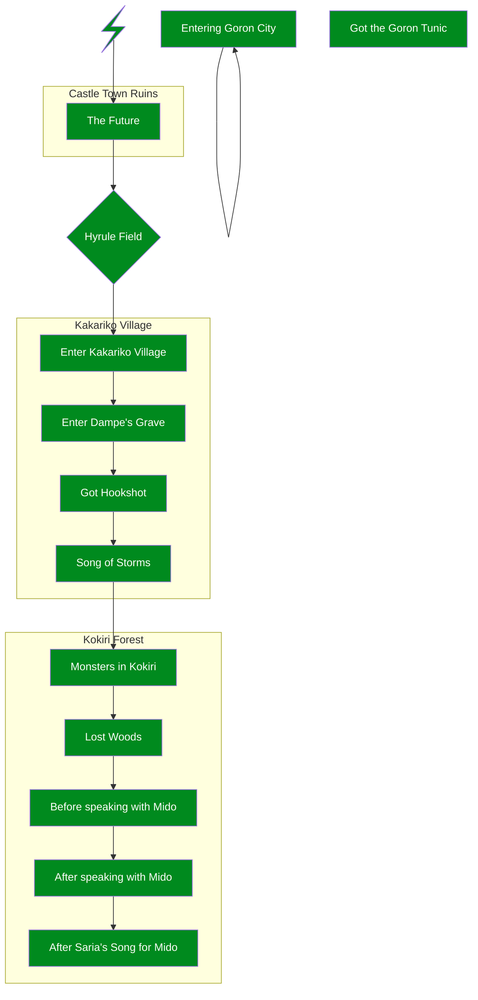

# Save Tree Graph
Click on a node below to go to its save files folder.

```mermaid
flowchart TD
	classDef default fill:#008a1e,color:white;
	classDef todo stroke-dasharray: 5 5,color:gray,fill:#FFFFFF88;
	
	000000{Game Start} --> 000100
	click 000000 href "https://github.com/tustin2121/OoTR-saveTree/blob/main/saves/000000_GameStart"
	
	subgraph ChildKokiri_01 [Kokiri Forest]
		000100[Talked to Saria] --> 000210 
		click 000100 href "https://github.com/tustin2121/OoTR-saveTree/blob/main/saves/000100_PostSaria"
		
		000210[Bought Deku Shield] --> 000220
		click 000210 href "https://github.com/tustin2121/OoTR-saveTree/blob/main/saves/000210_DekuShield"
		
		000220[Got Sword] --> 000250
		click 000220 href "https://github.com/tustin2121/OoTR-saveTree/blob/main/saves/000220_KokiriSword"
		
		000250[Passed Mido] -- Deku Tree's Task --> 000300
		click 000250 href "https://github.com/tustin2121/OoTR-saveTree/blob/main/saves/000250_PastMido"
		
		000300[Before Deku Tree] --> 000310
		click 000300 href "https://github.com/tustin2121/OoTR-saveTree/blob/main/saves/000300_BeforeDeku"
		
		subgraph DekuTree_01 [Deku Tree]
			000310[Inside Deku Tree] --> 000400
			click 000310 href "https://github.com/tustin2121/OoTR-saveTree/blob/main/saves/000310_InsideDeku"
			
			000400[Before Ghoma] --> 000450
			click 000400 href "https://github.com/tustin2121/OoTR-saveTree/blob/main/saves/000400_BeforeGhoma"
			
			000450[After Ghoma] 
			click 000450 href "https://github.com/tustin2121/OoTR-saveTree/blob/main/saves/000450_AfterGhoma"
		end
		
		000500["Spiritual Stone of Forest<br/>(1st stone)"] --> 000510
		000450 -- Deku Tree Dies --> 000500
		click 000500 href "https://github.com/tustin2121/OoTR-saveTree/blob/main/saves/000500_DekuDead"
		
		000510[After Mido runs off] --> 000520
		click 000510 href "https://github.com/tustin2121/OoTR-saveTree/blob/main/saves/000510_PostMido"
		
		000520[Before Saria's Cutscene]
		click 000510 href "https://github.com/tustin2121/OoTR-saveTree/blob/main/saves/000520_PreSaria"
	end
	
	001100[Hyrule Field Pre-Owl] -- Kaepora Gaebora --> 001110
	000520 --> 001100
	click 001100 href "https://github.com/tustin2121/OoTR-saveTree/blob/main/saves/001100_HFPreOwl"
	
	001110[Hyrule Field Post-Owl] --> 001150
	click 001110 href "https://github.com/tustin2121/OoTR-saveTree/blob/main/saves/001110_HFPostOwl"
	
	001150{Hyrule Field} --> 002000
	click 001150 href "https://github.com/tustin2121/OoTR-saveTree/blob/main/saves/001150_HyruleField"
	
	subgraph CastleTown_01 [Hyrule Castle Town]
		002000[Entering Hyrule Castle Town] --> 002100
		click 002000 href "https://github.com/tustin2121/OoTR-saveTree/blob/main/saves/002000_CastleTown"
		
		subgraph Castle_01 [Hyrule Castle]
			002100[Entering the Castle Grounds] --> 002110
			click 002100 href "https://github.com/tustin2121/OoTR-saveTree/blob/main/saves/002100_CastleEnter"
			
			002110[After Waking Talon] --> 002200
			click 002110 href "https://github.com/tustin2121/OoTR-saveTree/blob/main/saves/002110_TalonWoken"
			
			002200[Before Meeting Zelda] -- Meeting Zelda --> 002210
			click 002200 href "https://github.com/tustin2121/OoTR-saveTree/blob/main/saves/002200_BeforeZelda"
			
			002210[After Meeting Zelda] --> 002220
			click 002210 href "https://github.com/tustin2121/OoTR-saveTree/blob/main/saves/002210_AfterZelda"
			
			002220[After Learning Zelda's Lullaby]
			click 002220 href "https://github.com/tustin2121/OoTR-saveTree/blob/main/saves/002220_ZLLearned"
		end
	end
	
	003000{Hyrule Field} --> 003100
	002220 --> 003000
	click 003000 href "https://github.com/tustin2121/OoTR-saveTree/blob/main/saves/003000_StoneQuest"
	
	subgraph Kakariko_01 [Kakariko Village]
		003100[Kakariko Village] --> 003110
		click 003100 href "https://github.com/tustin2121/OoTR-saveTree/blob/main/saves/003100_KakarikoEnter"
		
		003110[Starting Cuckoo Quest] --> 003112
		click 003110 href "https://github.com/tustin2121/OoTR-saveTree/blob/main/saves/003110_CuckooQuest1"
		
		003112[Cuckoo Quest Bottle] --> 003120
		click 003112 href "https://github.com/tustin2121/OoTR-saveTree/blob/main/saves/003112_CuckooQuest2"
		
		003120["Guard Opened Gate<br/>(skipped Happy Mask Dialog)"] --> 003130
		click 003120 href "https://github.com/tustin2121/OoTR-saveTree/blob/main/saves/003120_AfterGuard"
		
		003130["Graveyard Shield"]
		click 003130 href "https://github.com/tustin2121/OoTR-saveTree/blob/main/saves/003130_GraveyardShield"
	end
	
	subgraph LonLon_01 [Lon Lon Ranch]
		003900[Lon Lon Ranch]
		class 003900 todo;
	%%	click 003900 href "https://github.com/tustin2121/OoTR-saveTree/blob/main/saves/001150_HyruleField"
	end
	003000 -.-> 003900
	
	subgraph DeathMountain_01 [Death Mountain]
		003200["Enter Death Mountain Trail"] --> 003300
		003130 --> 003200
		click 003200 href "https://github.com/tustin2121/OoTR-saveTree/blob/main/saves/003200_DMTEnter"
		
		subgraph GoronCity_01 [Goron City]
			003300["Enter Goron City"] -- Darunia's Crash Out --> 003310
			click 003300 href "https://github.com/tustin2121/OoTR-saveTree/blob/main/saves/003300_GCEnter"
			
			003310["After Darunia"]
			click 003310 href "https://github.com/tustin2121/OoTR-saveTree/blob/main/saves/003310_Darunia"
		end
	end
	003310 --> 003320
	
	subgraph LostWoods_01 [Lost Woods]
		003320["Enter Sacred Grove"] --> 003330
		click 003320 href "https://github.com/tustin2121/OoTR-saveTree/blob/main/saves/003320_SFMEnter"
		
		003330["Before Saria's Song"] --> 003331
		click 003330 href "https://github.com/tustin2121/OoTR-saveTree/blob/main/saves/003330_BeforeSong"
		
		003331["After Saria's Song"]
		click 003331 href "https://github.com/tustin2121/OoTR-saveTree/blob/main/saves/003331_AfterSong"
	end
	003331 --> 003400
	
	subgraph DeathMountain_02 [Death Mountain]
		subgraph GoronCity_02 [Goron City]
			003400["Return to Goron City"] -- Darunia's Dance --> 003410
			click 003400 href "https://github.com/tustin2121/OoTR-saveTree/blob/main/saves/003400_GCEnter"
			
			003410["Goron Bracelet Get"]
			click 003400 href "https://github.com/tustin2121/OoTR-saveTree/blob/main/saves/003410_PostDance"
		end
		
		004000["DC Opened"] --> 004100
		003410 --> 004000
		click 004000 href "https://github.com/tustin2121/OoTR-saveTree/blob/main/saves/004000_DCOpened"
		
		subgraph Dodongos_01 [Dodongo Cavern]
			004100["Dodongo Cavern Start"] --> 004110
			click 004100 href "https://github.com/tustin2121/OoTR-saveTree/blob/main/saves/004100_DCStart"
			
			004110["Get Bomb Bag"] --> 004120
			click 004110 href "https://github.com/tustin2121/OoTR-saveTree/blob/main/saves/004110_DCBombBag"
			
			004120["Before King Dodongo"] --> 004130
			click 004120 href "https://github.com/tustin2121/OoTR-saveTree/blob/main/saves/004120_DCBeforeBoss"
			
			004130["After King Dodongo"]
			click 004130 href "https://github.com/tustin2121/OoTR-saveTree/blob/main/saves/004130_DCAfterBoss"
		end
		004130 -- Darunia's Apology --> 004150
		
		004150["Spiritual Stone of Fire<br/>(2nd Stone)"] --> 004200
		click 004150 href "https://github.com/tustin2121/OoTR-saveTree/blob/main/saves/004150_FireStone"
		
		004200[Before the Great Fairy] --> 004210
		click 004200 href "https://github.com/tustin2121/OoTR-saveTree/blob/main/saves/004200_PreFairyDins"
		
		004210[Got Din's Fire] 
		click 004210 href "https://github.com/tustin2121/OoTR-saveTree/blob/main/saves/004210_DinsFire"
	end
	004210 --> 004220
		
	subgraph Kakariko_02 [Kakariko Village]
		004220[Atop the Village Roof]
		click 004220 href "https://github.com/tustin2121/OoTR-saveTree/blob/main/saves/004220_Rooftop"
	end
	004220 --> 004225
	
	004225{Hyrule Field} --> 004230
	class 004225 todo;
	%% click 004225 href "https://github.com/tustin2121/OoTR-saveTree/blob/main/saves/004225_HyruleField"
	
	subgraph CastleTown_02 [Hyrule Castle Town]
		004230[Castle Town Nighttime] --> 004240
		click 004230 href "https://github.com/tustin2121/OoTR-saveTree/blob/main/saves/004230_CastleTown"
		
		subgraph Castle_02 [Hyrule Castle]
			004240["Castle Grounds Nighttime (ft. Malon and Talon)"] --> 004250
			click 004240 href "https://github.com/tustin2121/OoTR-saveTree/blob/main/saves/004240_CastleGrounds"
			
			004250[Before the Great Fairy] --> 004260
			click 004250 href "https://github.com/tustin2121/OoTR-saveTree/blob/main/saves/004250_PreFairySpin"
			
			004260[Got Spin Attack] -- Impa directs to Zora --> 004270
			click 004260 href "https://github.com/tustin2121/OoTR-saveTree/blob/main/saves/004260_SpinAttack"
			
			004270[Princess Zelda at Night]
			click 004270 href "https://github.com/tustin2121/OoTR-saveTree/blob/main/saves/004270_Zelda"
		end
	end
	004270 --> 005000
	
	subgraph ZorasRiver_01 [Zora's River]
		005000[Enter Zora's River] --> 005100
		click 005000 href "https://github.com/tustin2121/OoTR-saveTree/blob/main/saves/005000_ZoraRiverStart"
		
		005100[Enter Zora's Domain] --> 005110
		click 005100 href "https://github.com/tustin2121/OoTR-saveTree/blob/main/saves/005100_ZDEnter"
		
		005110[Silver Scale]
		click 005110 href "https://github.com/tustin2121/OoTR-saveTree/blob/main/saves/005110_SilverScale"
	end
	
	005120[Lake Hylia Enter] --> 005130
	005110 --> 005120
	click 005120 href "https://github.com/tustin2121/OoTR-saveTree/blob/main/saves/005120_LHEnter"
	
	subgraph ZorasRiver_02 [Zora's River]
		005130[Before King Zora] -- Mweep Mweep Mweep Mweep --> 005140
		click 005130 href "https://github.com/tustin2121/OoTR-saveTree/blob/main/saves/005130_BeforeKing"
		
		005140[Enter Zora's Fountain] --> 005150
		click 005140 href "https://github.com/tustin2121/OoTR-saveTree/blob/main/saves/005140_AfterKing"
		
		005150[Got Farore's Wind] --> 006000
		click 005150 href "https://github.com/tustin2121/OoTR-saveTree/blob/main/saves/005150_FaroresWind"
		
		subgraph JabuJabu_01 [Lord Jabu-Jabu's Belly]
			006000[Enter Jabu] --> 006100
			click 006000 href "https://github.com/tustin2121/OoTR-saveTree/blob/main/saves/006000_JabuStart"
			
			006100[After Ruto Falls] --> 006200
			click 006100 href "https://github.com/tustin2121/OoTR-saveTree/blob/main/saves/006100_JabuRuto"
			
			006200[Back Upstairs] --> 006300
			click 006200 href "https://github.com/tustin2121/OoTR-saveTree/blob/main/saves/006200_JabuUpstairs"
			
			006300[Got Boomerang] --> 006400
			click 006300 href "https://github.com/tustin2121/OoTR-saveTree/blob/main/saves/006300_Boomerang"
			
			006400[Final Tentacle Dead] --> 006500
			click 006400 href "https://github.com/tustin2121/OoTR-saveTree/blob/main/saves/006400_LastTentacle"
			
			006500[After Mini-Boss] --> 006610
			click 006500 href "https://github.com/tustin2121/OoTR-saveTree/blob/main/saves/006500_AfterMiniboss"
			
			006610[Before Baranade] --> 006620
			click 006610 href "https://github.com/tustin2121/OoTR-saveTree/blob/main/saves/006610_BeforeBoss"
			
			006620[After Baranade] --> 006650
			click 006620 href "https://github.com/tustin2121/OoTR-saveTree/blob/main/saves/006620_AfterBoss"
		end
		
		006650["Spiritual Stone of Water<br/>(3rd stone)"]
		click 006650 href "https://github.com/tustin2121/OoTR-saveTree/blob/main/saves/006650_WaterStone"
	end
	
	007100[Lake Hylia] -- Owl Flight --> 007000
	006650 --> 007100
	click 007100 href "https://github.com/tustin2121/OoTR-saveTree/blob/main/saves/007100_LakeHylia"
	
	
	%% ------- Alternate Spiritual Stone Quest ------- %%
	
	004110 --> A04225
	A04225{Hyrule Field} --> A04230
	class A04225 todo;
	%% click A04225 href "https://github.com/tustin2121/OoTR-saveTree/blob/main/saves/A04225_HyruleField"
	
	subgraph CastleTown_02A [Hyrule Castle Town]
		A04230[Castle Town Nighttime] --> A04240
		class A04230 todo; 
		%% click A04230 href "https://github.com/tustin2121/OoTR-saveTree/blob/main/saves/A04230_CastleTown"
		
		subgraph Castle_02A [Hyrule Castle]
			A04240["Castle Grounds Nighttime (ft. Malon and Talon)"] --> A04250
			class A04240 todo; 
			%% click A04240 href "https://github.com/tustin2121/OoTR-saveTree/blob/main/saves/A04240_CastleGrounds"
			
			A04250[Before the Great Fairy] --> A04260
			class A04250 todo; 
			%% click A04250 href "https://github.com/tustin2121/OoTR-saveTree/blob/main/saves/A04250_PreFairySpin"
			
			A04260[Got Spin Attack] -- Impa directs to Zora --> A04270
			class A04260 todo; 
			%% click A04260 href "https://github.com/tustin2121/OoTR-saveTree/blob/main/saves/A04260_SpinAttack"
			
			A04270[Princess Zelda at Night]
			class A04270 todo; 
			%% click A04270 href "https://github.com/tustin2121/OoTR-saveTree/blob/main/saves/A04270_Zelda"
		end
	end
	A04270 --> A05000
	
	subgraph ZorasRiver_01A [Zora's River]
		A05000[Enter Zora's River] --> A05100
		class A05000 todo; 
		%% click A05000 href "https://github.com/tustin2121/OoTR-saveTree/blob/main/saves/A05000_ZoraRiverStart"
		
		A05100[Enter Zora's Domain] --> A05110
		class A05100 todo; 
		%% click A05100 href "https://github.com/tustin2121/OoTR-saveTree/blob/main/saves/A05100_ZDEnter"
		
		A05110[Silver Scale]
		class A05110 todo; 
		%% click A05110 href "https://github.com/tustin2121/OoTR-saveTree/blob/main/saves/A05110_SilverScale"
	end
	
	A05120[Lake Hylia Enter] --> A05130
	class A05120 todo; 
	A05110 --> A05120
	%% click A05120 href "https://github.com/tustin2121/OoTR-saveTree/blob/main/saves/A05120_LHEnter"
	
	subgraph ZorasRiver_02A [Zora's River]
		A05130[Before King Zora] -- Mweep Mweep Mweep Mweep --> A05140
		class A05130 todo; 
		%% click A05130 href "https://github.com/tustin2121/OoTR-saveTree/blob/main/saves/A05130_BeforeKing"
		
		A05140[Enter Zora's Fountain] --> A05150
		class A05140 todo; 
		%% click A05140 href "https://github.com/tustin2121/OoTR-saveTree/blob/main/saves/A05140_AfterKing"
		
		A05150[Got Farore's Wind] --> A06000
		class A05150 todo; 
		%% click A05150 href "https://github.com/tustin2121/OoTR-saveTree/blob/main/saves/A05150_FaroresWind"
		
		subgraph JabuJabu_01A [Lord Jabu-Jabu's Belly]
			A06000[Enter Jabu] --> A06100
			class A06000 todo; 
			%% click A06000 href "https://github.com/tustin2121/OoTR-saveTree/blob/main/saves/A06000_JabuStart"
			
			A06100[After Ruto Falls] --> A06200
			class A06100 todo; 
			%% click A06100 href "https://github.com/tustin2121/OoTR-saveTree/blob/main/saves/A06100_JabuRuto"
			
			A06200[Back Upstairs] --> A06300
			class A06200 todo; 
			%% click A06200 href "https://github.com/tustin2121/OoTR-saveTree/blob/main/saves/A06200_JabuUpstairs"
			
			A06300[Got Boomerang] --> A06400
			class A06300 todo; 
			%% click A06300 href "https://github.com/tustin2121/OoTR-saveTree/blob/main/saves/A06300_Boomerang"
			
			A06400[Final Tentacle Dead] --> A06500
			class A06400 todo; 
			%% click A06400 href "https://github.com/tustin2121/OoTR-saveTree/blob/main/saves/A06400_LastTentacle"
			
			A06500[After Mini-Boss] --> A06610
			class A06500 todo; 
			%% click A06500 href "https://github.com/tustin2121/OoTR-saveTree/blob/main/saves/A06500_AfterMiniboss"
			
			A06610[Before Baranade] --> A06620
			class A06610 todo; 
			%% click A06610 href "https://github.com/tustin2121/OoTR-saveTree/blob/main/saves/A06610_BeforeBoss"
			
			A06620[After Baranade] --> A06650
			class A06620 todo; 
			%% click A06620 href "https://github.com/tustin2121/OoTR-saveTree/blob/main/saves/A06620_AfterBoss"
		end
		
		A06650["Spiritual Stone of Water<br/>(2nd stone)"]
		class A06650 todo; 
		%% click A06650 href "https://github.com/tustin2121/OoTR-saveTree/blob/main/saves/A06650_WaterStone"
	end
	A06650 --> A04120
	
	subgraph DeathMountain_02A [Death Mountain]
		subgraph Dodongos_02A [Dodongo Cavern]
			A04120["Before King Dodongo"] --> A04130
			class A04120 todo;
		%%	click A04120 href "https://github.com/tustin2121/OoTR-saveTree/blob/main/saves/A04120_DCBeforeBoss"
			
			A04130["After King Dodongo"]
			class A04130 todo;
		%%	click A04130 href "https://github.com/tustin2121/OoTR-saveTree/blob/main/saves/A04130_DCAfterBoss"
		end
		A04130 -- Darunia's Apology --> A04150
		
		A04150["Spiritual Stone of Fire (3rd Stone)"]
		class A04150 todo;
		%%click A04150 href "https://github.com/tustin2121/OoTR-saveTree/blob/main/saves/A04150_FireStone"
	end
	A04150 -.-> 007000
	
	%% ------- Alternate Timelines ------- %%
	
	004150 -- "(Forgot Magic)" --> M05000
	subgraph ZorasRiver_02NoMagic ["Zora's River (Forgot Magic)"]
		M05000[Enter Zora's River] --> M05100
		click M05000 href "https://github.com/tustin2121/OoTR-saveTree/blob/main/saves/M05000_ZoraRiverStart"
		
		M05100[Enter Zora's Domain] --> M05110
		click M05100 href "https://github.com/tustin2121/OoTR-saveTree/blob/main/saves/M05100_ZDEnter"
		
		M05110[Silver Scale] --> M05120
		click M05110 href "https://github.com/tustin2121/OoTR-saveTree/blob/main/saves/M05110_SilverScale"
	
		subgraph LakeHylia_02NoMagic [Lake Hylia]
			M05120[Lake Hylia Enter] --> M05130
			click M05120 href "https://github.com/tustin2121/OoTR-saveTree/blob/main/saves/M05120_LHEnter"
		end
	
		M05130[Before King Zora] -- Mweep Mweep --> M05140
		click M05130 href "https://github.com/tustin2121/OoTR-saveTree/blob/main/saves/M05130_BeforeKing"
		
		M05140[Enter Zora's Fountain] -- "Oh, forgot magic" --> M05160
		click M05140 href "https://github.com/tustin2121/OoTR-saveTree/blob/main/saves/M05140_AfterKing"
		
		M05160[After Getting Din's Fire] --> M05170
		click M05160 href "https://github.com/tustin2121/OoTR-saveTree/blob/main/saves/M05160_DMCOops"
		
		M05170["Before Getting Spin Attack<br/>(Malon at Castle)"] --> M05180
		click M05170 href "https://github.com/tustin2121/OoTR-saveTree/blob/main/saves/M05170_CastleOops"
		
		M05180["After Getting Spin Attack<br/>(No Impa)"]
		click M05180 href "https://github.com/tustin2121/OoTR-saveTree/blob/main/saves/M05180_CastleOops"
	end

	%% ------- End of Child 1 ------- %%
	
	007000{Hyrule Field}
	click 007000 href "https://github.com/tustin2121/OoTR-saveTree/blob/main/saves/007000_HyruleField"
	
	007000 -- "Zelda's Escape<br/>(Cannot Save)" --> 
	
	%% 007200[/"Zelda's Escape<br/>(Cannot Save)"/] --> 007210
	%% click 007200 href "https://github.com/tustin2121/OoTR-saveTree/blob/main/saves/007200_AfterEscape"
	
	007210["Got Ocarina of Time"] --> 007250
	click 007210 href "https://github.com/tustin2121/OoTR-saveTree/blob/main/saves/007210_AfterOcarina"
	
	subgraph CastleTown_03 [Hyrule Castle Town]
		007250["Castle Town<br/>(ft. Malon & Talon)"] --> 007290
		click 007250 href "https://github.com/tustin2121/OoTR-saveTree/blob/main/saves/007250_CastleTown"
		
		007290["The Master Sword Awaits"]
		click 007290 href "https://github.com/tustin2121/OoTR-saveTree/blob/main/saves/007290_DoorOfTime"
	end

	%% ------- Master Sword ------- %%
	
	MasterSwordCS@{ shape: trap-b, label: "Master Sword<br/>Cutscene" }
	style MasterSwordCS fill:gray;
	TimeTravel_01@{ shape: bolt, label: "." }
	007290 --> MasterSwordCS --> TimeTravel_01
	
```


