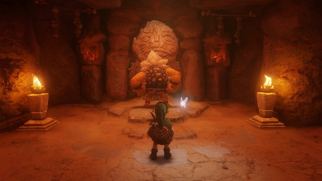

##  Goron City
GoronCity/GoronCity_Child @ (-0.15, 98.42, -37.00) / -48.48&deg;

Autosaved at 2026/11/21 at 21:47:58  
Progress: [🟢|]   
❤️ 6/12  
💀 0 💰️ 60  
Songs: [💤|]  

<!-- 47 entries:
  0x89ae7032 ShadowMedallion =  0
  0x50c6bedf GoronRuby =  0
  0x238ae327 SongZelda =  1
  0xf941212 SongSaria =  0
  0xab6b5962 SongStorms =  0
  0x380a5616 SongTime =  0
  0xe1ca50c6 WaterMedallion =  0
  0x75bd1ecf ForestMedallion =  0
  0x2f61ab71 ZoraSapphire =  0
  0x17464eb8 SongFire =  0
  0x10dc0608 FireMedallion =  0
  0xfb2b5f6b SongSuns =  0
  0x85f5194d SongWater =  0
  0xba6a1b74 SpiritMedallion =  0
  0x2f793671  =  0
  0x59ce596 LightMedallion =  0
  0x91288adc SongEpona =  0
  0x1eda08d5  =  0
  0x574aef59 SongShadow =  0
  0x25f03caa AutoSaveMarker =  1
  0xc72044fc PostGame =  0
  0xf9d63fd4 SongLight =  0
  0x99b50b91 SongForest =  0
  0x7c5b03dc FieldMusicStart =  1
  0x83254520 SongSpirit =  0
  0xe8bd6759 DoubleDefense =  0
  0xfb112756 KokiriEmerald =  1
  0xdc941483 GSCount =  0
  0xbd46f485 FileSaved_Day =  21
  0x23f3d75e FileSaved_Hour =  21
  0x5ee50bed FileSaved_Second =  58
  0x9811a3f7 FileSaved_Year =  2026
  0x27853bf7 FileSaved_Minute =  47
  0xdfd840d3 FileSaved_Month =  11
  0x943f8ec3 MagicMax =  0
  0x1e55ecc5 HeartsCurr =  6
  0x74bd05d0 HeartsMax =  12
  0x19f26b6a MagicCurr =  0
  0xa9557547 RupeeCount =  60
  0xaccbda17 LinkRotation =  -48.475807189941406
  0x8b26618e LinkPosition =  672
  0xcccc6cd MapPath =  684
  0xf74e0e8e MapName =  748
  0x47c0901e  =  812
  0x63696a32 Thumbnail =  1392
  0x51c58419  =  0
  0x26f3523b  =  0
-->